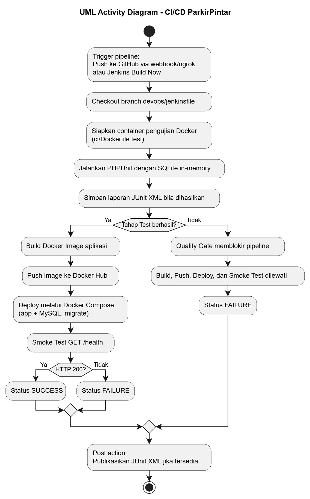

# ParkirPintar

Layanan manajemen parkir gedung perkantoran dengan karcis digital: area parkir dan kapasitas per jenis kendaraan, check-in, check-out dengan perhitungan tarif otomatis, serta laporan okupansi dan pendapatan.

Tugas Besar 1 Komputasi Awan 2026-2027 (CI/CD Pipeline Jenkins), **Kelompok 7, studi kasus K07 ParkirPintar**.

## Tim

| Nama | Peran |
|---|---|
| Firza  | Tech Lead / Backend |
| Fadhil | DevOps Engineer |
| Jingga | Container Engineer |
| Rafi   | QA Engineer & Tech Writer |

## Stack

- Laravel (PHP 8.3), REST API (JSON)
- MySQL
- Test: PHPUnit lewat `php artisan test`
- Container: Docker + Docker Compose
- CI/CD: Jenkins + GitHub Webhook (Ngrok)

## Fitur

- CRUD area parkir dan kapasitas per jenis kendaraan (motor/mobil)
- Check-in kendaraan (plat nomor, jenis, area)
- Check-out dengan perhitungan tarif
- Laporan okupansi per area dan pendapatan per hari
- Endpoint `GET /health` (status aplikasi dan koneksi database)

## Aturan bisnis

**Tarif**

| Jenis | Jam pertama | Jam berikutnya | Maksimal per hari |
|---|---|---|---|
| Motor | Rp2.000 | Rp1.000 per jam | Rp20.000 |
| Mobil | Rp5.000 | Rp3.000 per jam | Rp50.000 |

- Durasi dibulatkan ke atas per jam (61 menit dihitung 2 jam).
- Durasi 15 menit atau kurang: gratis (Rp0). Lewat dari itu, ditagih dari total durasi.
- Batas harian berlaku per blok 24 jam. Parkir 25 jam = 1 blok penuh + tarif 1 jam untuk sisanya.

**Check-in**
- Ditolak (409) jika plat yang sama masih berstatus ACTIVE.
- Ditolak (409) jika area penuh untuk jenis kendaraan tersebut. Kapasitas dihitung per area dan per jenis kendaraan.
- Plat dinormalisasi (huruf besar, spasi tunggal): `b  1234 xyz` menjadi `B 1234 XYZ`.

**Check-out**
- Mengubah record ACTIVE menjadi DONE, mengisi `check_out_at` dan `fee`.
- Ditolak (404) jika tidak ada record ACTIVE untuk plat tersebut.

**Area parkir**
- Nama area unik.
- Kapasitas tidak boleh diturunkan di bawah jumlah kendaraan yang sedang parkir (422).
- Area yang sudah punya riwayat parkir tidak bisa dihapus (409). Set kapasitas ke 0 sebagai gantinya.

## Endpoint API

Semua request API wajib memakai header `Accept: application/json`, kalau tidak Laravel membalas dengan redirect, bukan JSON.

| Method | URL | Keterangan |
|---|---|---|
| GET | `/health` | Status aplikasi. 200 jika database terhubung, 503 jika tidak |
| GET | `/api/areas` | Daftar area |
| POST | `/api/areas` | Tambah area |
| GET | `/api/areas/{id}` | Detail area |
| PUT | `/api/areas/{id}` | Ubah area |
| DELETE | `/api/areas/{id}` | Hapus area |
| POST | `/api/check-in` | Check-in kendaraan |
| POST | `/api/check-out` | Check-out kendaraan |
| GET | `/api/reports/occupancy` | Laporan okupansi per area |
| GET | `/api/reports/revenue?date=YYYY-MM-DD` | Laporan pendapatan per hari (default: hari ini) |

Contoh body:

```json
// POST /api/areas  (juga untuk PUT)
{ "name": "Gedung A", "capacity_motor": 50, "capacity_mobil": 20 }

// POST /api/check-in
{ "plate_number": "B 1234 XYZ", "vehicle_type": "motor", "parking_area_id": 1 }

// POST /api/check-out
{ "plate_number": "B 1234 XYZ" }
```

## Menjalankan di lokal

### Prasyarat

- PHP 8.3 dengan ekstensi: `pdo_mysql`, `pdo_sqlite`, `mbstring`, `openssl`, `fileinfo`, `curl`, `zip`
- Composer
- Git
- MySQL (misalnya dari XAMPP) dengan database kosong bernama `parkirpintar`

### Langkah

```bash
git clone https://github.com/ParkirPintar-Kelompok-7/ParkirPintar
cd ParkirPintar
composer install
cp .env.example .env        # di CMD/PowerShell: copy .env.example .env
php artisan key:generate
```

Buat database `parkirpintar` (lewat phpMyAdmin atau `CREATE DATABASE parkirpintar;`), cek isi `.env` sesuai MySQL Anda, lalu:

```bash
php artisan migrate --seed
php artisan serve
```

Buka `http://127.0.0.1:8000/health`. Hasil yang benar:

```json
{"status":"ok","database":"up"}
```

## Menjalankan test

```bash
php artisan test
```

Test memakai SQLite in-memory (diatur di `phpunit.xml`), jadi tidak menyentuh database MySQL lokal dan tidak butuh MySQL saat dijalankan di container atau Jenkins. Semua test harus hijau sebelum membuka Pull Request.

## Variabel lingkungan

`.env` **tidak boleh di-commit**. Yang di-commit hanya `.env.example` (tanpa password asli).

| Variabel | Contoh | Keterangan |
|---|---|---|
| `APP_NAME` | `ParkirPintar` | Nama aplikasi |
| `APP_ENV` | `local` | `production` saat deploy |
| `APP_KEY` | (hasil `php artisan key:generate`) | Wajib terisi |
| `APP_DEBUG` | `true` | Harus `false` saat deploy |
| `APP_URL` | `http://localhost:8000` | URL aplikasi |
| `APP_TIMEZONE` | `Asia/Jakarta` | Opsional, default sudah Asia/Jakarta |
| `DB_CONNECTION` | `mysql` | |
| `DB_HOST` | `127.0.0.1` | Di Docker Compose: nama service database |
| `DB_PORT` | `3306` | |
| `DB_DATABASE` | `parkirpintar` | |
| `DB_USERNAME` | `root` | |
| `DB_PASSWORD` | (kosong di lokal) | Di server/Jenkins: simpan sebagai secret |

## Alur kerja Git (wajib dibaca semua anggota)

Aturan utama:

1. **Dilarang push langsung ke `main`.** Semua perubahan lewat branch, lalu Pull Request (PR), lalu merge.
2. **Jangan pernah commit** `.env`, token, atau password. Cek dengan `git status` sebelum commit.
3. **Setiap anggota harus punya commit sendiri** di repo ini (dinilai dari riwayat GitHub).

### Pertama kali (sekali saja per laptop)

Atur identitas supaya commit tercatat atas nama Anda:

```bash
git config --global user.name "Nama Anda"
git config --global user.email "email-yang-dipakai-di-github"
```

Clone repo (Anda harus sudah diundang sebagai collaborator):

```bash
git clone <url-repo-kelompok>
cd <nama-folder-repo>
```

Kalau diminta login, pakai login lewat browser atau Personal Access Token. Password akun GitHub tidak lagi diterima untuk Git.

### Setiap kali mulai bekerja

```bash
git checkout main
git pull                                  # ambil perubahan terbaru
git checkout -b <nama-branch>             # contoh: docker/dockerfile, devops/jenkinsfile, qa/readme
```

Penamaan branch: `<bidang>/<hal-singkat>`, contoh `docker/compose`, `devops/jenkinsfile`, `feature/laporan`.

### Setelah selesai mengerjakan sesuatu

```bash
git status                                # pastikan tidak ada .env atau file rahasia
git add .
git commit -m "Pesan singkat tentang apa yang diubah"
git push -u origin <nama-branch>
```

Lalu di GitHub: klik **Compare & pull request**, isi judul, **Create pull request**. Minta satu anggota lain melihatnya, lalu **Merge pull request**.

### Setelah PR ter-merge

```bash
git checkout main
git pull
git branch -d <nama-branch>
```

### Kalau `main` sudah berubah saat Anda masih mengerjakan branch

```bash
git checkout main
git pull
git checkout <nama-branch>
git merge main
```

Kalau muncul conflict, buka file yang ditandai di VS Code, pilih versi yang benar, simpan, lalu `git add .` dan `git commit`.

## Catatan untuk Container Engineer

- Port aplikasi: **8000**. Cara paling sederhana: `php artisan serve --host=0.0.0.0 --port=8000`.
- Base image yang disarankan: `php:8.3-cli`. Tambahkan ekstensi `pdo_mysql` (`docker-php-ext-install pdo_mysql`). `pdo_sqlite` sudah ada di image resmi.
- Composer: salin dari image `composer`. Stage test pakai `composer install` (dengan dev dependency), stage final pakai `composer install --no-dev --optimize-autoloader`.
- **Stage test:** jalankan `php artisan test`. Tidak butuh MySQL. Tapi `APP_KEY` harus ada: lakukan `cp .env.example .env && php artisan key:generate` di dalam stage, atau kirim `APP_KEY` sebagai environment variable. Tanpa itu, test akan gagal dengan `MissingAppKeyException`.
- **Migrasi:** jalankan `php artisan migrate --force` setelah database healthy dan sebelum smoke test. Untuk data contoh: `php artisan db:seed --force`. Perhatikan: `/health` hanya mengecek koneksi database, bukan keberadaan tabel.
- Variabel yang wajib dikirim ke container aplikasi: `APP_KEY`, `APP_ENV=production`, `APP_DEBUG=false`, dan semua `DB_*`. `DB_HOST` adalah nama service database di `compose.yaml`.
- Tambahkan `.dockerignore` untuk `vendor`, `.git`, `.env`, dan `node_modules`.

## Catatan untuk DevOps Engineer

- Smoke test: `curl -fsS http://localhost:8000/health` (gagal jika status bukan 200). Boleh ditambah `curl -fsS http://localhost:8000/api/reports/occupancy -H "Accept: application/json"`.
- Perintah test: `php artisan test`. Untuk laporan JUnit (tantangan K07): `vendor/bin/phpunit --log-junit storage/logs/junit.xml`, lalu publikasikan dengan langkah `junit` di blok `post { always { ... } }`.
- Jumlah test saat ini lebih dari 60 dan berjalan dalam hitungan detik.
- `Jenkinsfile` ada di root repository. Credential (Docker Hub, GitHub, secret file `.env`) disimpan di Jenkins Credentials, bukan di kode.

## Troubleshooting

| Masalah | Penyebab dan solusi |
|---|---|
| `could not find driver` | Ekstensi `pdo_mysql` atau `pdo_sqlite` belum aktif. Hapus tanda `;` di depan `extension=...` di `php.ini`, lalu buka terminal baru |
| `composer install` timeout | Masalah jaringan atau DNS. Coba hotspot, ganti DNS ke `8.8.8.8`, atau matikan IPv6 di adapter WiFi |
| `No application encryption key has been generated` | Jalankan `php artisan key:generate` |
| `Your local changes would be overwritten by merge` | Commit dulu perubahan Anda, atau simpan sementara dengan `git stash` |
| `git push` ditolak | Jalankan `git pull` lalu push ulang |
| Port 8000 dipakai | `php artisan serve --port=8001` |
| Respons API berupa halaman HTML / redirect | Tambahkan header `Accept: application/json` |

---

## Quality Assurance dan CI/CD Pipeline

### Automated Testing

ParkirPintar menggunakan PHPUnit untuk menjalankan unit test dan feature test secara otomatis. Pengujian menggunakan database SQLite in-memory agar tidak mengganggu database MySQL aplikasi.

Pengujian lokal dapat dijalankan dengan perintah `php artisan test`.

Pada Jenkins, automated testing dijalankan di dalam container Docker. Hasil pengujian disimpan dalam format JUnit XML dan dipublikasikan melalui Jenkins Test Result.

### Pengujian Tambahan QA Engineer

QA Engineer menambahkan tiga skenario pengujian pada file `tests/Feature/QABusinessFlowTest.php`, yaitu:

1. Menolak check-in dengan plat nomor yang masih ACTIVE di area parkir lain dengan HTTP 409.
2. Memastikan motor yang parkir tepat 15 menit tidak dikenakan biaya.
3. Memastikan motor yang parkir selama 15 menit 1 detik dikenakan biaya Rp2.000.

Pengujian tambahan tersebut telah digabungkan melalui Pull Request #11 ke branch `main`.

### Tahapan CI/CD Jenkins

Pipeline Jenkins ParkirPintar terdiri dari enam tahap:

| Tahap | Keterangan |
|---|---|
| Checkout | Mengambil source code dari GitHub |
| Test | Menjalankan PHPUnit dan membuat laporan JUnit XML |
| Build Image | Membangun Docker image aplikasi |
| Push Image | Mengunggah image ke Docker Hub |
| Deploy | Menjalankan aplikasi menggunakan Docker Compose |
| Smoke Test | Memeriksa endpoint `/health` dengan HTTP 200 |

Tahap Test berfungsi sebagai Quality Gate. Apabila automated testing gagal, Jenkins menghentikan pipeline sehingga proses build dan deployment tidak dilanjutkan.

### UML Activity Diagram CI/CD

Diagram berikut menggambarkan proses CI/CD dari trigger GitHub atau Build Now hingga deployment aplikasi, termasuk mekanisme Quality Gate ketika pengujian gagal.



File diagram yang dapat diedit:

[CI_CD_ACTIVITY.drawio](docs/CI_CD_ACTIVITY.drawio)

Dokumentasi alur pipeline:

[CI_CD_PIPELINE.md](docs/CI_CD_PIPELINE.md)

### Demonstrasi Quality Gate FAILED dan SUCCESS

Pengujian Quality Gate dilakukan melalui simulasi satu PHPUnit test yang sengaja gagal menggunakan fitur Jenkins Replay, kemudian dilanjutkan dengan eksekusi pipeline normal.

| Build | Hasil | Tests | Assertions | Failures |
|---|---|---:|---:|---:|
| #19 | FAILURE | 72 | 186 | 1 |
| #20 | SUCCESS | 71 | 185 | 0 |

#### Jenkins Build #19 — FAILURE

Build #19 merupakan simulasi menggunakan Jenkins Replay dari Build #17. Satu test sementara bernama `QualityGateDemoTest.php` dibuat di dalam container pengujian dengan assertion `assertTrue(false)`.

Hasil PHPUnit menunjukkan 72 tests, 186 assertions, dan 1 failure.

Jenkins menghentikan pipeline pada tahap Test. Tahap Build Image, Push Image, Deploy, dan Smoke Test tidak dijalankan.

Laporan JUnit XML tetap berhasil direkam. Simulasi ini tidak mengubah source code maupun Jenkinsfile asli di GitHub.

#### Jenkins Build #20 — SUCCESS

Build #20 dijalankan menggunakan Build Now dengan Jenkinsfile asli dari branch `devops/jenkinsfile`.

Seluruh 71 automated test berhasil dengan 185 assertions dan tanpa kegagalan.

Docker image berhasil dibuat dan diunggah ke Docker Hub menggunakan tag `fdhil17/parkirpintar:20` dan `fdhil17/parkirpintar:latest`.

Deployment Docker Compose berhasil menjalankan aplikasi dan database MySQL 8.4 dengan status healthy.

Endpoint `/health` memberikan HTTP 200 dengan respons:

`{"status":"ok","database":"up"}`

Seluruh tahap Jenkins berhasil dijalankan dengan status akhir SUCCESS.

### Hasil Pengujian Quality Gate

Perbandingan Build #19 dan Build #20 membuktikan bahwa Quality Gate dapat menghentikan proses deployment ketika automated testing gagal dan mengizinkan deployment ketika seluruh pengujian berhasil.

Hasil ini digunakan sebagai bukti implementasi QA dan CI/CD pada Tugas Besar Komputasi Awan Kelompok 7.
