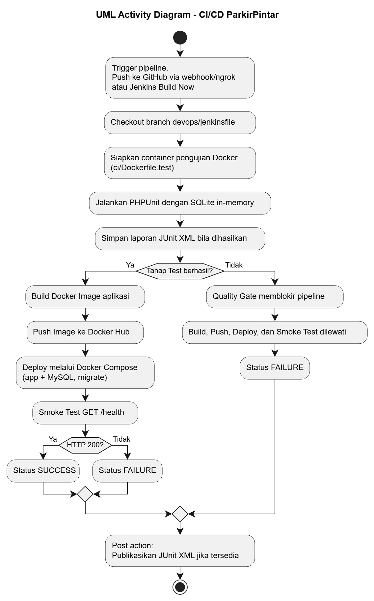

# Diagram Alur CI/CD ParkirPintar

## Ringkasan Alur
Pipeline CI/CD ParkirPintar dijalankan menggunakan Jenkins dan terhubung dengan GitHub webhook. Setiap perubahan pada branch yang dipantau akan memicu pipeline secara otomatis.

## Tahapan Pipeline
1. **Trigger dari GitHub Webhook**
   Pipeline dimulai ketika ada push ke repository dan webhook GitHub mengirim request ke Jenkins.

2. **Checkout Source Code**
   Jenkins mengambil source code terbaru dari repository GitHub.

3. **Build Docker Test Image**
   Jenkins membangun image pengujian menggunakan file `ci/Dockerfile.test`.

4. **Menjalankan Automated Test**
   Jenkins menjalankan PHPUnit/feature test dengan environment pengujian berbasis SQLite in-memory.

5. **Quality Gate**
   Jika ada test yang gagal, pipeline langsung berhenti pada tahap ini dan proses build/deploy tidak dilanjutkan.

6. **Build Docker Image Produksi**
   Jika seluruh test lolos, Jenkins membangun image aplikasi produksi.

7. **Push Image ke Docker Hub**
   Image produksi yang berhasil dibangun akan dikirim ke repository Docker Hub.

8. **Deploy dengan Docker Compose**
   Jenkins menjalankan deployment menggunakan `compose.deploy.yaml`.

9. **Smoke Test**
   Setelah deployment selesai, Jenkins memeriksa endpoint `/health` untuk memastikan aplikasi dan database berjalan dengan baik.

## Hasil Implementasi
Pipeline telah berhasil menunjukkan dua skenario:
- **Skenario gagal**, saat test sengaja dibuat gagal untuk membuktikan quality gate menghentikan pipeline.
- **Skenario berhasil**, saat test diperbaiki kembali dan pipeline berjalan sukses hingga tahap deploy dan smoke test.

## Catatan
Dokumentasi ini dibuat untuk melengkapi hasil pengerjaan QA Engineer & Tech Writer pada proyek ParkirPintar.
